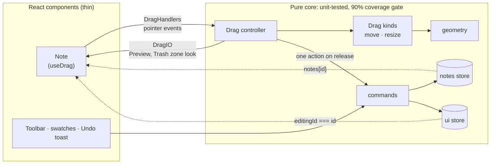

# Sticky Notes

A single-page desktop app for placing, arranging and resizing sticky notes on a board. It is written in React and TypeScript, with no component libraries.

**Live app:** https://juanccastillog80.github.io/sticky-notes/ (deployed from `main` on every merge)

## What it does

| Feature                                              | Status                                                                                                 |
| ---------------------------------------------------- | ------------------------------------------------------------------------------------------------------ |
| 1. Create a note of a given size at a given position | Done: double-click empty Board (default size, centred on the pointer), or the S/M/L toolbar buttons    |
| 2. Change note size by dragging                      | Done: any of the 4 edges or 4 corners, with a minimum size, stopping at the Board's edges              |
| 3. Move a note by dragging                           | Done: a Dead zone before the drag starts, wheel-scroll while dragging, Escape cancels                  |
| 4. Remove a note on a trash zone                     | Done: drop a Note with the pointer on the bottom-right Trash zone, or click its ×; both offer Undo     |
| Bonus I: edit note text                              | Done: click a Note to type, caret where you clicked; a new Note opens ready to type                    |
| Bonus II: bring to front                             | Done: pressing a Note Raises it                                                                        |
| Bonus III: note colours                              | Done: six toolbar swatches recolour the Note being edited, or set the Current colour for the next Note |

**Keyboard.** Tab and Shift+Tab move through the Notes in creation order, each followed by its ×. A focused Note is Raised and shows a focus ring. Enter starts Editing with the caret at the end, Escape ends it and leaves focus on the Note, and Delete or Backspace deletes the Note (with Undo) and focuses the next one. Moving and resizing from the keyboard aren't built. In Safari, Tab skips buttons unless "Press Tab to highlight each item on a webpage" is on (Settings → Advanced), or use Option+Tab.

The words used here and in the code (Board, Note, Drag, Drag kind, Preview, Dead zone, Raise…) are defined in [`GLOSSARY.md`](GLOSSARY.md).

### Not included

The brief asks for 3 of the 4 features; all 4 are built. The bonuses are being added one at a time, to the same standard, since they make the UI better.

- **localStorage and REST saving (bonuses IV, V)** are not built yet. The persistence design is recorded in [ADR 0002](docs/adr/0002-local-first-persistence-msw.md). The groundwork is in place: an MSW service worker intercepts real `fetch` calls on the deployed site, and the app sends one `GET /notes` at startup. It doesn't save anything yet, so notes are lost on reload. The planned `?fail=&latency=` URL parameters for demoing failed and slow saves belong to that work and don't exist yet.

## Setup

Requires Node 26 (see `.nvmrc`).

```sh
npm ci
npx playwright install chromium firefox   # for the browser tests
npm run dev                                # http://localhost:5173/sticky-notes/
```

| Script                 | What it does                                                                  |
| ---------------------- | ----------------------------------------------------------------------------- |
| `npm run dev`          | Vite dev server                                                               |
| `npm run build`        | Typecheck, then production build into `dist/`                                 |
| `npm run preview`      | Serve the production build                                                    |
| `npm run typecheck`    | `tsc -b`                                                                      |
| `npm run lint`         | ESLint and Prettier check                                                     |
| `npm test`             | All tests: unit (Node) and browser (Chromium and Firefox, through Playwright) |
| `npm run test:unit`    | Unit tests only, including type-level tests                                   |
| `npm run test:browser` | Browser tests only. `BROWSERS=chrome,msedge,firefox` picks the browsers       |
| `npm run coverage`     | Unit coverage, with a 90% gate on the pure core                               |

CI runs every check on each PR, and runs the browser tests again in Chrome, Edge and Firefox on Windows and in Chrome and Firefox on macOS. A merge to `main` deploys to GitHub Pages.

## Architecture

The UI layer is thin. The decisions are made in a pure core that never touches the DOM, and that core holds them all: how a Drag behaves, the geometry, and the state changes.



Solid arrows are calls. Dotted arrows are selector subscriptions, which decide what re-renders.

### 1. One Drag engine, specialised by pure Drag kinds

Moving and resizing share everything except what they show and what they save.

- **Lifecycle.** _Mount_: `useDrag` creates one controller per Note. _Session_: a Press Raises the Note and attaches the listeners. The Dead zone then decides whether it is a Click or a Drag, moves and scrolls update the Preview, and release or cancel ends it. _Unmount_: a running Drag is cancelled.
- **No DOM in the controller.** `createDragController` (`src/drag/controller.ts`) talks to the DOM through two narrow interfaces, one for each direction. `DragIO` goes from the controller to the DOM: read scroll, attach listeners, write the Preview, draw the Trash zone, dispatch, report a Click. `DragHandlers` goes from the DOM to the controller: move, up, cancel, scroll, key. `useDrag` passes the real DOM. The unit tests pass a recording fake.
- **Kinds are pure functions** (`src/drag/kinds.ts`): `press` (the Raise), `preview` and `commit`, over the same geometry. What you release is therefore exactly what you saw. Resize was added as a second kind without changing the controller. The Trash zone belongs to the move kind: its `commit` returns a delete when the pointer is inside the zone.
- **React stays out of the hot path.** During a Drag the Preview is written straight to the Note's style. After the Raise, React renders nothing until release, when one action is dispatched.
- **A Click starts Editing.** A Press released inside the Dead zone is a Click, which puts the caret where you clicked. A Press inside text only Raises, so typing and selecting work normally. The Grip strip always moves the Note.

### 2. Two small stores, read through selectors

- **`createStore`** (`src/store/createStore.ts`) is a pure reducer behind `useSyncExternalStore`. The **notes** store holds each Note's position, size, text, colour and place in the Stacking order. The **ui** store holds the Note being edited, the Current colour and the Note that Undo would bring back.
- **Re-render only what changed.** The reducers keep every unchanged Note and the `ids` array at the same reference, and a no-op returns the same state and notifies nobody. The Board subscribes to `ids` and each Note to `notes[id]`, so moving one Note re-renders only that Note. `useIsEditing(id)` is a boolean per Note, so a change of Editing re-renders only the two Notes involved.
- **Rules that span both stores live in `commands.ts`**, so each reducer knows only its own store. Creating a Note gives it the Current colour and opens it in Editing. Deleting one ends its Editing and records it for Undo. Recolouring a Note also sets the Current colour. A Drag's commit goes through commands too, so a drop on the Trash zone gets the same Undo as the ×.
- The stores and commands reach components through a context whose value never changes. Reading it never causes a render, only subscriptions do.
- **Geometry is pure** (`src/geometry.ts`): clamping to the Board, the minimum size and resize maths. The reducer and the Drag kinds share it.

### 3. Keyboard and focus

- Each Note's `<article>` can be focused, followed in the Tab order by its ×. Keyboard focus (`:focus-visible`) Raises the Note, but a right-button press, which also focuses it, does not.
- Enter starts Editing, and Escape returns focus to the Note. Delete deletes the Note and moves focus to the next one, so the user keeps their place.
- The × is not a Press: it never Raises or drags. After it deletes a Note, `ignorePressesFor` swallows the second half of a double-click, so it can't land on the Note that was underneath.

### 4. A fixed Board; persistence planned as local-first

- The Board is a fixed 1920×1080 surface that scrolls under the toolbar ([ADR 0001](docs/adr/0001-fixed-scrolling-board.md)). A Note's stored position can never become invalid when the window shrinks. A Drag adds the scroll delta, so the Note stays under the pointer while the wheel scrolls.
- `main.tsx` is the composition root. It builds the stores, renders, and only then starts the MSW worker. The worker is loaded as a separate chunk, so the first paint never waits on the network.
- The planned persistence ([ADR 0002](docs/adr/0002-local-first-persistence-msw.md)) follows changes in state rather than living inside the UI. The Local copy shows first, and a real HTTP client talks to a mocked backend (`src/mocks/`) that can be deleted without touching the client.

### Testing

The pure core (controller, kinds, reducers, commands, geometry) is unit-tested in Node, with property-based tests for the geometry, and is held to the coverage gate. Components are tested in real browsers through Playwright, including `<Profiler>` tests that check moving, resizing, typing in, recolouring or deleting one Note re-renders no other.

Each merged PR has an interactive code walkthrough, listed at https://juanccastillog80.github.io/sticky-notes/walkthroughs/. The engine is explained in [move notes](https://juanccastillog80.github.io/sticky-notes/walkthroughs/0004-move-notes.html) and [resize notes](https://juanccastillog80.github.io/sticky-notes/walkthroughs/0005-resize-notes.html), the Trash zone in [trash zone](https://juanccastillog80.github.io/sticky-notes/walkthroughs/0006-trash-zone.html), and the keyboard in [keyboard navigation](https://juanccastillog80.github.io/sticky-notes/walkthroughs/0033-keyboard-navigation.html).

## Known limits

- Notes are kept in memory only: a reload starts from an empty Board (see "Not included").
- Once persistence exists, syncing several tabs won't be handled: across tabs, the last save wins.
- Browser tests run in Chromium and Firefox on every PR, and also in Chrome and Edge on real Windows and macOS runners. None are skipped or retried. Any Firefox flakiness found will be recorded here rather than silenced.
- Desktop pointer input only. Touch and pen aren't targeted, per the brief.

## Cross-browser sign-off

Manual pass at 1024×768 and on a large monitor, in the latest Chrome, Edge and Firefox: see [`docs/cross-browser-checklist.md`](docs/cross-browser-checklist.md).
