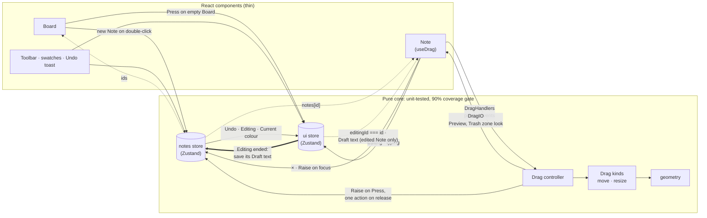

# Sticky Notes

A single-page desktop app for placing, arranging and resizing sticky notes on a board. It is written in React and TypeScript, with no component libraries.

**Live app:** https://juanccastillog80.github.io/sticky-notes/ (deployed from `main` on every merge)

## What it does

| Feature                                              | Status                                                                                                  |
| ---------------------------------------------------- | ------------------------------------------------------------------------------------------------------- |
| 1. Create a note of a given size at a given position | Done: S/M/L add a Note and set the Current size; double-click empty Board adds one at the pointer       |
| 2. Change note size by dragging                      | Done: any of the 4 edges or 4 corners, with a minimum size, stopping at the Board's edges               |
| 3. Move a note by dragging                           | Done: a Dead zone before the drag starts, wheel-scroll while dragging, Escape cancels                   |
| 4. Remove a note on a trash zone                     | Done: drop a Note so it overlaps the bottom-right Trash zone; Undo restores it                          |
| Bonus I: edit note text                              | Done: click a Note to type, caret where you clicked; a new Note opens ready to type                     |
| Bonus II: bring to front                             | Done: pressing a Note Raises it                                                                         |
| Bonus III: note colours                              | Done: six toolbar swatches recolour the Note being edited, or set the Current colour for the next Note  |
| Bonus IV: save to localStorage                       | Done: the Board survives a reload; changes are saved 300 ms after the last one, and when the tab closes |
| Extra (not in the brief): × on each Note             | Deletes the Note in one click, with Undo. Quicker than dragging it across the Board                     |

**Keyboard.** Tab and Shift+Tab move through the Notes in creation order, each followed by its ×. A focused Note is Raised and shows a focus ring. Enter starts Editing with the caret at the end, Escape ends it and leaves focus on the Note, and Delete or Backspace deletes the Note (with Undo) and focuses the next one. Moving and resizing from the keyboard aren't built. In Safari, Tab skips buttons unless "Press Tab to highlight each item on a webpage" is on (Settings → Advanced), or use Option+Tab.

**Starting over.** The Board is kept in this browser's localStorage. To clear it, clear the site's data (DevTools → Application → Storage → Clear site data) and reload, or use a private window, which starts empty and forgets the Board when it closes.

The words used here and in the code (Board, Note, Drag, Drag kind, Preview, Dead zone, Raise…) are defined in [`GLOSSARY.md`](GLOSSARY.md).

### Not included

The brief asks for 3 of the 4 features; all 4 are built. The bonuses are being added one at a time, to the same standard, since they make the UI better.

- **REST saving (bonus V)** is not built. Notes are kept only in this browser's Local copy.

## Setup

Requires Node 26 (see `.nvmrc`).

```sh
npm ci
npx playwright install chromium firefox   # for the browser tests
npm run dev                                # http://localhost:5173/sticky-notes/
```

| Script                 | What it does                                                                  |
| ---------------------- | ----------------------------------------------------------------------------- |
| `npm run dev`          | Vite dev server                                                               |
| `npm run build`        | Typecheck, then production build into `dist/`                                 |
| `npm run preview`      | Serve the production build                                                    |
| `npm run typecheck`    | `tsc -b`                                                                      |
| `npm run lint`         | ESLint and Prettier check                                                     |
| `npm test`             | All tests: unit (Node) and browser (Chromium and Firefox, through Playwright) |
| `npm run test:unit`    | Unit tests only, including type-level tests                                   |
| `npm run test:browser` | Browser tests only. `BROWSERS=chrome,msedge,firefox` picks the browsers       |
| `npm run coverage`     | Unit coverage, with a 90% gate on the pure core                               |

CI runs every check on each PR, and runs the browser tests again in Chrome, Edge and Firefox on Windows and in Chrome and Firefox on macOS. A merge to `main` deploys to GitHub Pages.

## Architecture

The UI layer is thin. The decisions are made in a pure core that never touches the DOM, and that core holds them all: how a Drag behaves, the geometry, and the state changes.



Solid arrows are calls. Dotted arrows are selector subscriptions, which decide what re-renders. The thick arrow is the Notes store following the UI store: however Editing ends, it saves the Draft text to the Note.

### 1. One Drag engine, specialised by pure Drag kinds

Moving and resizing share everything except what they show and what they save.

- **Lifecycle.** _Mount_: `useDrag` creates one controller per Note. _Session_: a Press Raises the Note and attaches the listeners. The Dead zone then decides whether it is a Click or a Drag, moves and scrolls update the Preview, and release or cancel ends it. _Unmount_: a running Drag is cancelled.
- **No DOM in the controller.** `createDragController` (`src/drag/controller.ts`) talks to the DOM through two narrow interfaces, one for each direction. `DragIO` goes from the controller to the DOM: read scroll, the Board's size and the Board's and Trash zone's place on screen, attach listeners, write the Preview, draw the Trash zone, save through the Notes store's actions, report a Click. `DragHandlers` goes from the DOM to the controller: move, up, cancel, scroll, key. `useDrag` passes the real DOM. The unit tests pass a recording fake.
- **Kinds are small and stateless** (`src/drag/kinds.ts`): `press` (the Raise), `preview` and `commit`, over the same geometry. `preview` is pure, and `commit` saves the rect it computes the same way, through the `save` it is given (`raise`, `move`, `resize`, `deleteNote`). What you release is therefore exactly what you saw. Resize was added as a second kind without changing the controller. The Trash zone belongs to the move kind: its `commit` calls `deleteNote` when the Note's Preview rect, placed on screen by the Board's origin (measured at press, less the scroll since), overlaps the zone. The zone's highlight asks the same question, so it always predicts what a release does.
- **React stays out of the hot path.** During a Drag the Preview is written straight to the Note's style. After the Raise, React renders nothing until release, when one action is called.
- **A Click starts Editing.** A Press released inside the Dead zone is a Click, which puts the caret where you clicked. A Press inside text only Raises, so typing and selecting work normally. The Grip strip always moves the Note.

### 2. Two small stores, read through selectors

- **Two [Zustand](https://zustand.docs.pmnd.rs) vanilla stores** with named actions, so tests and the Drag engine can read and write them outside React: `notes.getState().move(id, x, y)`. The **notes** store (`src/notes/notesStore.ts`) holds each Note's position, size, text, colour and place in the Stacking order. The **ui** store (`src/ui/uiStore.ts`) holds the Note being edited and its Draft text, the Current colour and the Note that Undo would bring back. Editing's rule (Escape or pressing anywhere else ends it) lives in one place, `src/ui/editing.ts`: callers only report what happened (`startEditing`, `typed`, `pressed`, `escaped`, `deleted`, `pageHidden`), and its pure transitions decide whether Editing ends and record why (`editingEndedBy`), so `Note` puts focus back on the article only after Escape. Typing changes only the Draft text; however Editing ends, `endedDraft` hands it over and the Notes store saves it to the Note, once. Components subscribe with Zustand's `useStore(store, selector)`, wrapped as `useNotes` and `useUi`, and call actions from event handlers.
- **Re-render only what changed.** Each Notes action runs a pure transition (`transitions` in `notesStore.ts`, unit-tested on its own) that keeps every unchanged Note and the `ids` array at the same reference. A no-op returns the same state, so Zustand notifies nobody. The Board subscribes to `ids` and each Note to `notes[id]`, so moving one Note re-renders only that Note. `useIsEditing(id)` is a boolean per Note, so a change of Editing re-renders only the two Notes involved. Only the edited Note's textarea subscribes to the Draft text, so typing re-renders it alone.
- **Rules that span both stores are Notes actions.** The Notes store is given the UI store when it is created (`createStores()`); the UI store never needs the Notes store back. `createNoteAt` (double-click) and `createNoteInView` (the S/M/L buttons) give the new Note the Current colour and size, place it inside the Board's current size, and open it in Editing; the components only measure the DOM and pass plain points and rects. `deleteNote` reports the delete to Editing, which saves the Draft text, and only then records the Note for Undo, so Undo brings the typed text back. The Notes store also follows the UI store, to save the Draft text whenever Editing ends. `recolour` also sets the Current colour. A drop on the Trash zone calls `deleteNote` too, so it gets the same Undo as the ×.
- The stores reach components through a context whose value never changes, so tests can build their own. Reading it never causes a render, only subscriptions do.
- **Geometry is pure** (`src/geometry.ts`): clamping to a Board size it is given, the minimum size, resize maths, the Notes' extent and the rect overlap test. The Notes transitions and the Drag kinds share it.

### 3. Keyboard and focus

- Each Note's `<article>` can be focused, followed in the Tab order by its ×. Keyboard focus (`:focus-visible`) Raises the Note, but a right-button press, which also focuses it, does not.
- Enter starts Editing, and Escape returns focus to the Note. Delete deletes the Note and moves focus to the next one, so the user keeps their place.
- The × is not a Press: it never Raises or drags. After it deletes a Note, `ignorePressesFor` swallows the second half of a double-click, so it can't land on the Note that was underneath.

### 4. A Board that fits the window; the Local copy

- The Board fills the visible area below the toolbar, so an empty Board has no scrollbars at any window size. It grows only to hold Notes that reach further, which happens when the window shrinks below them: the Board then scrolls to them, and their stored position is never rewritten ([ADR 0003](docs/adr/0003-board-fits-window.md), superseding [ADR 0001](docs/adr/0001-fixed-scrolling-board.md)). CSS takes the larger of the visible area and the Notes' extent, so the Board follows the window on the same frame. A Drag measures the Board once at press and stays inside it, so dragging never grows the Board. A Drag adds the scroll delta, so the Note stays under the pointer while the wheel scrolls.
- `main.tsx` is the composition root. It builds the stores, loads the Local copy into them, starts saving, and only then renders, so a reload never flashes an empty Board.
- The Local copy ([ADR 0002](docs/adr/0002-local-copy.md)) follows changes in the Notes store rather than living inside the UI: `saveLocalCopy` subscribes to it and writes the whole Board 300 ms after the last change, flushing on `pagehide`. `parseNotes` guards what is read back, so a damaged copy is discarded with a warning instead of crashing the app.

### Testing

The pure core (controller, kinds, stores and their transitions, geometry) is unit-tested in Node, with property-based tests for the geometry, and is held to the coverage gate. Components are tested in real browsers through Playwright, including `<Profiler>` tests that check moving, resizing, typing in, recolouring or deleting one Note re-renders no other.

Each merged PR has an interactive code walkthrough, listed at https://juanccastillog80.github.io/sticky-notes/walkthroughs/. The engine is explained in [move notes](https://juanccastillog80.github.io/sticky-notes/walkthroughs/0004-move-notes.html) and [resize notes](https://juanccastillog80.github.io/sticky-notes/walkthroughs/0005-resize-notes.html), the Trash zone in [trash zone](https://juanccastillog80.github.io/sticky-notes/walkthroughs/0006-trash-zone.html), and the keyboard in [keyboard navigation](https://juanccastillog80.github.io/sticky-notes/walkthroughs/0033-keyboard-navigation.html).

## Known limits

- Notes are saved only in this browser. Syncing several tabs isn't handled: across tabs, the last save wins. If the browser blocks site data, Notes are kept in memory only, with a warning in the console.
- Browser tests run in Chromium and Firefox on every PR, and also in Chrome and Edge on real Windows and macOS runners. None are skipped or retried. Any Firefox flakiness found will be recorded here rather than silenced.
- Desktop pointer input only. Touch and pen aren't targeted, per the brief.

## Cross-browser sign-off

Manual pass at 1024×768 and on a large monitor, in the latest Chrome, Edge and Firefox: see [`docs/cross-browser-checklist.md`](docs/cross-browser-checklist.md).
