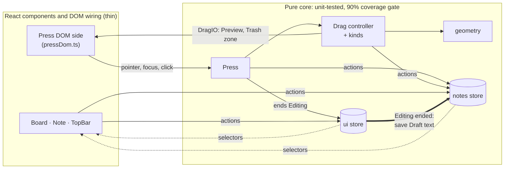

# Sticky Notes

A single-page desktop app for placing, arranging and resizing sticky notes on a board. It is written in React and TypeScript, with no component libraries.

**Live app:** https://juanccastillog80.github.io/sticky-notes/ (deployed from `main` on every merge)

## What it does

| Feature                                              | Status                                                                                                  |
| ---------------------------------------------------- | ------------------------------------------------------------------------------------------------------- |
| 1. Create a note of a given size at a given position | Done: S/M/L pick the Current size; double-click empty Board adds a Note of that size at the pointer     |
| 2. Change note size by dragging                      | Done: any of the 4 edges or 4 corners, with a minimum size, stopping at the Board's edges               |
| 3. Move a note by dragging                           | Done: a Dead zone before the drag starts, wheel-scroll while dragging, Escape cancels                   |
| 4. Remove a note on a trash zone                     | Done: drop a Note so it overlaps the bottom-right Trash zone; Undo restores it                          |
| Bonus I: edit note text                              | Done: click a Note to type, caret where you clicked; a new Note opens ready to type                     |
| Bonus II: bring to front                             | Done: pressing a Note Raises it                                                                         |
| Bonus III: save to localStorage                      | Done: the Board survives a reload; changes are saved 300 ms after the last one, and when the tab closes |
| Bonus IV: note colours                               | Done: six toolbar swatches recolour the Note being edited, or set the Current colour for the next Note  |
| Extra (not in the brief): × on each Note             | Deletes the Note in one click, with Undo. Quicker than dragging it across the Board                     |

**Keyboard.** Tab and Shift+Tab move through the Notes in creation order, each followed by its ×. A focused Note is Raised and shows a focus ring. Enter starts Editing with the caret at the end, Escape ends it and leaves focus on the Note, and Delete or Backspace deletes the Note (with Undo) and focuses the next one. Creating, moving and resizing Notes from the keyboard aren't built. In Safari, Tab skips buttons unless "Press Tab to highlight each item on a webpage" is on (Settings → Advanced), or use Option+Tab.

**Starting over.** The Board is kept in this browser's localStorage. To clear it, clear the site's data (DevTools → Application → Storage → Clear site data) and reload, or use a private window, which starts empty and forgets the Board when it closes.

The words used here and in the code (Board, Note, Drag, Drag kind, Preview, Dead zone, Raise…) are defined in [`GLOSSARY.md`](GLOSSARY.md).

### Not included

The brief asks for 3 of the 4 features; all 4 are built, along with bonuses I to IV.

- **REST saving (bonus V)** is not built. Notes are kept only in this browser's Local copy.

## Setup

Requires Node 26 (see `.nvmrc`).

```sh
npm ci
npx playwright install chromium firefox   # for the browser tests
npm run dev                                # http://localhost:5173/sticky-notes/
```

| Script                 | What it does                                                                  |
| ---------------------- | ----------------------------------------------------------------------------- |
| `npm run dev`          | Vite dev server                                                               |
| `npm run build`        | Typecheck, then production build into `dist/`                                 |
| `npm run preview`      | Serve the production build                                                    |
| `npm run typecheck`    | `tsc -b`                                                                      |
| `npm run lint`         | ESLint and Prettier check                                                     |
| `npm test`             | All tests: unit (Node) and browser (Chromium and Firefox, through Playwright) |
| `npm run test:unit`    | Unit tests only, including type-level tests                                   |
| `npm run test:browser` | Browser tests only. `BROWSERS=chrome,msedge,firefox` picks the browsers       |
| `npm run coverage`     | Unit coverage, with a 90% gate on the pure core                               |

CI runs every check on each PR, and runs the browser tests again in Chrome, Edge and Firefox on Windows and in Chrome and Firefox on macOS. A merge to `main` deploys to GitHub Pages.

## Architecture

The UI is thin, and the decisions live in a pure core that never touches the DOM. One Press module (`src/press/`) decides what the pointer going down means: Raise, end Editing, start a Drag, or create a Note on a double-click. Moving and resizing share one Drag controller, written once, that talks to the DOM only through a narrow `DragIO` interface. Each Drag kind (`src/drag/kinds.ts`) is a pair of pure functions: `preview` for what you see while dragging, and `commit` for what is saved, computed from the same geometry, so what you release is exactly what you saw. During a Drag the Preview is written straight to the Note's style, and React renders nothing until release. A drop deletes the Note when its rect overlaps the Trash zone, which is the same question the zone's highlight asks.

State lives in two small [Zustand](https://zustand.docs.pmnd.rs) stores: **notes** (position, size, text, colour, Stacking order) and **ui** (the Note being edited, the Current colour and size, Undo); the edited Note keeps its own Draft text until Editing ends. Every action is a pure transition that keeps unchanged Notes at the same reference, and each component subscribes to only its own slice, so moving or typing in one Note re-renders that Note alone. Browser tests with `<Profiler>` check this. The Board fills the window and grows only to hold Notes that reach past it ([ADR 0003](docs/adr/0003-board-fits-window.md)).

The Board is saved to a Local copy in localStorage that follows the Notes store from outside the UI: it writes 300 ms after the last change and again on `pagehide`, and it is loaded before the first render, so a reload never flashes an empty Board ([ADR 0002](docs/adr/0002-local-copy.md)). The pure core is unit-tested in Node behind a 90% coverage gate, and the components are tested in real browsers. Each module's responsibilities are described in [`docs/architecture.md`](docs/architecture.md), and the PRs that shaped the architecture have [interactive code walkthroughs](https://juanccastillog80.github.io/sticky-notes/walkthroughs/).



Solid arrows are calls, dotted arrows are selector subscriptions, and the thick arrow is the Notes store saving the Draft text whenever Editing ends.

## Known limits

- Notes are saved only in this browser. Syncing several tabs isn't handled: across tabs, the last save wins. If the browser blocks site data, Notes are kept in memory only, with a warning in the console.
- Browser tests run on every PR in the browsers listed under Setup. None are skipped or retried.
- Desktop pointer input only. Touch and pen aren't targeted, per the brief.

## Cross-browser sign-off

[`docs/cross-browser-checklist.md`](docs/cross-browser-checklist.md) lists every user story with the automated tests that cover it in Chrome, Edge and Firefox, and the results of a scripted Playwright pass over the live app in Chrome and Firefox at 1024×768 and 1920×1080 ([`docs/checklist/run.mjs`](docs/checklist/run.mjs)). Apart from one row checked by hand in Firefox, it was not run by hand. Its findings are listed at the end.
