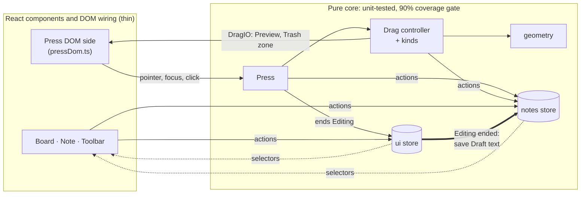

# Architecture in detail

The README gives the short version. This page has the full design: what each module owns, and why.

The UI layer is thin. The decisions are made in a pure core that never touches the DOM, and that core holds them all: what a press means, how a Drag behaves, the geometry, and the state changes.

Solid arrows are calls. Dotted arrows are selector subscriptions, which decide what re-renders. The thick arrow is the Notes store following the UI store: however Editing ends, it saves the Draft text to the Note.

## 1. One Press module decides what the pointer going down means

Everything that happens when the pointer goes down is in `src/press/`, so a new Press target can't skip a rule (#51 was the × forgetting to end Editing).

- **A pure core** (`createPress` in `src/press/press.ts`) takes three inputs: the pointer going down on a Press target (a Note's body, Grip strip or Resize handle, its ×, empty Board) or outside the Board; focus arriving on a Note, with whether it came from the keyboard; a click on a ×, with whether it was a mouse click. It owns the Raise (on a Press, and on keyboard focus only), ending Editing on a press anywhere on the Board but the edited Note (the × included, though it is no Press), a press inside text that only Raises, the Click's caret offset (carried by Editing, read once by the editor), the double-click on empty Board that creates a Note, and the window after a mouse click on a × in which presses on Notes near that point are ignored. It is unit-tested in Node with the real stores, the real Drag controller and a fake `DragIO`.
- **The DOM side** (`src/press/pressDom.ts`), attached once by the Board in an effect, is the only module that listens on `document`: a capture-phase `pointerdown` there, and `focusin`, `click` and `dblclick` on the Board. It reads the Press target from `data-press-target`, `data-note-id` and `data-handle`, so `Note` renders markup and handles keys only. It also owns the one Drag controller and its real `DragIO`. A Note deleted while it is held (from the keyboard) ends its Drag at once.

## 2. One Drag engine, specialised by pure Drag kinds

Moving and resizing share everything except what they show and what they save.

- **Lifecycle.** _Mount_: the Press module creates one controller for the Board. _Session_: a Press (already Raised by the Press module) attaches the listeners. The Dead zone then decides whether it is a Click or a Drag, moves and scrolls update the Preview, and release or cancel ends it. _Unmount_: a running Drag is cancelled.
- **No DOM in the controller.** `createDragController` (`src/drag/controller.ts`) talks to the DOM through two narrow interfaces, one for each direction. `DragIO` goes from the controller to the DOM: read scroll, the Board's size and the Board's and Trash zone's place on screen, attach listeners, write the Preview, draw the Trash zone, save through the Notes store's actions, report a Click. `DragHandlers` goes from the DOM to the controller: move, up, cancel, scroll, key. `pressDom.ts` passes the real DOM, with the pressed Note as the Preview element. The unit tests pass a recording fake.
- **Kinds are small and stateless** (`src/drag/kinds.ts`): `preview` and `commit`, over the same geometry, and nothing else: the Raise is the Press's. `preview` is pure, and `commit` saves the rect it computes the same way, through the `save` it is given (`move`, `resize`, `deleteNote`). What you release is therefore exactly what you saw. Resize was added as a second kind without changing the controller. The Trash zone belongs to the move kind: its `commit` calls `deleteNote` when the Note's Preview rect, placed on screen by the Board's origin (measured at press, less the scroll since), overlaps the zone. The zone's highlight asks the same question, so it always predicts what a release does.
- **React stays out of the hot path.** During a Drag the Preview is written straight to the Note's style. After the Raise, React renders nothing until release, when one action is called.
- **A Click starts Editing.** A Press released inside the Dead zone is a Click, which puts the caret where you clicked. A Press inside text only Raises, so typing and selecting work normally. The Grip strip always moves the Note.

## 3. Two small stores, read through selectors

- **Two [Zustand](https://zustand.docs.pmnd.rs) vanilla stores** with named actions, so tests and the Drag engine can read and write them outside React: `notes.getState().move(id, x, y)`. The **notes** store (`src/notes/notesStore.ts`) holds each Note's position, size, text, colour and place in the Stacking order. The **ui** store (`src/ui/uiStore.ts`) holds the Note being edited, the Current colour and size, and the Note that Undo would bring back. Editing's rule (Escape or pressing anywhere else ends it) lives in one place, `src/ui/editing.ts`: callers only report what happened (`startEditing`, `pressed`, `escaped`, `deleted`, `pageHidden`), and its pure transitions decide whether Editing ends and record why (`editingEndedBy`), so `Note` puts focus back on the article only after Escape. The Draft text lives in the edited Note's textarea (`NoteEditor`), as its own React state, so typing touches no store. When it mounts, it lends the ui store a way to read it (`holdDraft`), kept outside the store's state so lending notifies nobody; however Editing ends, `endedEditing` names the Note and the Notes store reads its Draft text (`readDraft`) and saves it to the Note, once, synchronously. Components subscribe with Zustand's `useStore(store, selector)`, wrapped as `useNotes` and `useUi`, and call actions from event handlers.
- **Re-render only what changed.** Each Notes action runs a pure transition (`transitions` in `notesStore.ts`, unit-tested on its own) that keeps every unchanged Note and the `ids` array at the same reference. A no-op returns the same state, so Zustand notifies nobody. The Board subscribes to `ids` and each Note to `notes[id]`, so moving one Note re-renders only that Note. `useIsEditing(id)` is a boolean per Note, so a change of Editing re-renders only the two Notes involved. The Draft text is the edited Note's textarea's own state, so typing re-renders it alone.
- **Rules that span both stores are Notes actions.** The Notes store is given the UI store when it is created (`createStores()`); the UI store never needs the Notes store back. `createNoteAt` (double-click, the only way to create a Note) gives the new Note the Current colour and size, centres it on the pointer inside the Board's current size, and opens it in Editing; the Press module only measures the DOM and passes a plain point and size. The S/M/L buttons only set the Current size. `deleteNote` reports the delete to Editing, which saves the Draft text, and only then records the Note for Undo, so Undo brings the typed text back. The Notes store also follows the UI store, to save the Draft text whenever Editing ends. `recolour` also sets the Current colour. A drop on the Trash zone calls `deleteNote` too, so it gets the same Undo as the ×.
- The stores reach components through a context whose value never changes, so tests can build their own. Reading it never causes a render, only subscriptions do.
- **Geometry is pure** (`src/geometry.ts`): clamping to a Board size it is given, the minimum size, resize maths, the Notes' extent and the rect overlap test. The Notes transitions and the Drag kinds share it.

## 4. Keyboard and focus

- Each Note's `<article>` can be focused, followed in the Tab order by its ×. Keyboard focus (`:focus-visible`) Raises the Note, but a right-button press, which also focuses it, does not (the Press module decides both).
- Enter starts Editing, and Escape returns focus to the Note. Delete deletes the Note and moves focus to the next one, so the user keeps their place.
- The × is not a Press: it never Raises or drags. After a mouse click on it deletes a Note, the Press module ignores presses on Notes within a few pixels of that click for a double-click's time, so the second half can't land on the Note that was underneath. Presses elsewhere, such as a quick click on another Note's ×, act at once. Enter or Space on a × is never ignored.

## 5. A Board that fits the window; the Local copy

- The Board fills the visible area below the toolbar, so an empty Board has no scrollbars at any window size. It grows only to hold Notes that reach further, which happens when the window shrinks below them: the Board then scrolls to them, and their stored position is never rewritten ([ADR 0003](adr/0003-board-fits-window.md), superseding [ADR 0001](adr/0001-fixed-scrolling-board.md)). CSS takes the larger of the visible area and the Notes' extent, so the Board follows the window on the same frame. A Drag measures the Board once at press and stays inside it, so dragging never grows the Board. A Drag adds the scroll delta, so the Note stays under the pointer while the wheel scrolls.
- `main.tsx` is the composition root. It builds the stores, loads the Local copy into them, starts saving, and only then renders, so a reload never flashes an empty Board.
- The Local copy ([ADR 0002](adr/0002-local-copy.md)) follows changes in the Notes store rather than living inside the UI: `saveLocalCopy` subscribes to it and writes the whole Board 300 ms after the last change, flushing on `pagehide`. `parseNotes` guards what is read back, so a damaged copy is discarded with a warning instead of crashing the app.

## Testing

The pure core (Press, controller, kinds, stores and their transitions, geometry) is unit-tested in Node, with property-based tests for the geometry, and is held to the coverage gate. Components are tested in real browsers through Playwright, including `<Profiler>` tests that check moving, resizing, typing in, recolouring or deleting one Note re-renders no other.

The PRs that shaped the architecture have interactive code walkthroughs, listed at https://juanccastillog80.github.io/sticky-notes/walkthroughs/. The engine is explained in [move notes](https://juanccastillog80.github.io/sticky-notes/walkthroughs/0004-move-notes.html) and [resize notes](https://juanccastillog80.github.io/sticky-notes/walkthroughs/0005-resize-notes.html), the Trash zone in [trash zone](https://juanccastillog80.github.io/sticky-notes/walkthroughs/0006-trash-zone.html), and the keyboard in [keyboard navigation](https://juanccastillog80.github.io/sticky-notes/walkthroughs/0033-keyboard-navigation.html).
